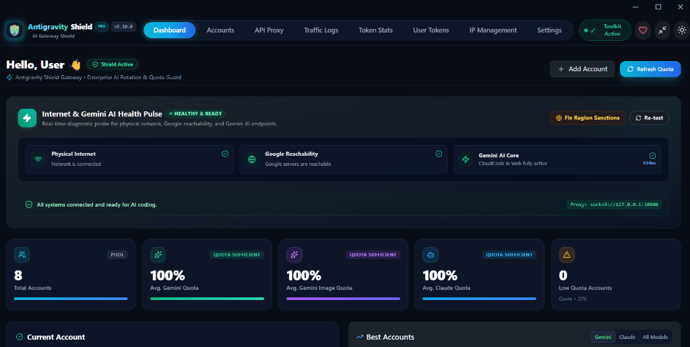
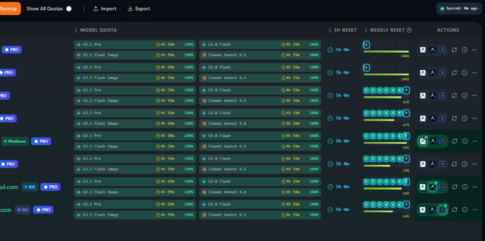
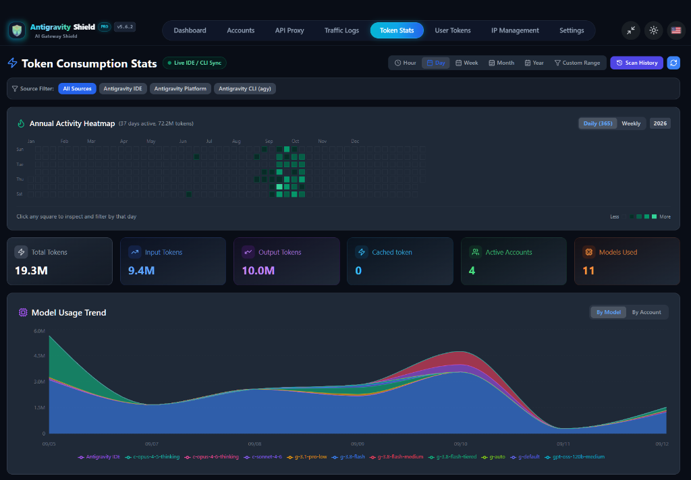
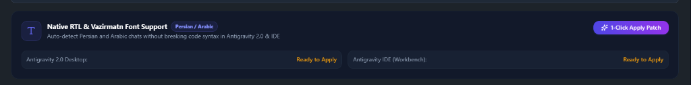

# Antigravity Shield 🛡️
> **Enterprise High-Performance AI Account Manager, Universal Agent Skills Marketplace & Zero-Leak Multi-IDE Protocol Gateway**  
> *Version 6.0.1 — Engineered with Rust (Axum / Tokio) & React 19 (Tauri 2.x)*

<div align="center">
  

  <h3>Autonomous AI Quota Routing • 1,000+ Agent Skills • Zero-Leak Security • Zero-Restart IDE Hot-Switching</h3>
  <p dir="rtl">
    <strong>شیلد آنتی‌گرویتی:</strong> گیت‌وی پرسرعت مدیریت سهمیه چند حسابه هوش مصنوعی، مارکت‌پلیس جهانی مهارت‌های ایجنت و معماری امنیت محلی Zero-Leak
  </p>

  <p>
    <a href="https://github.com/doctorguidance/antigravity-shield/releases"></a>
    
    
    
    
    
    
    
  </p>

  <p>
    <a href="#-executive-overview">Executive Overview</a> • 
    <a href="#-core-architectural-pillars">Core Pillars</a> • 
    <a href="#-universal-agent-ecosystem--marketplace">Skills Marketplace</a> • 
    <a href="#-system-architecture">Architecture</a> • 
    <a href="#-quick-integration">Integration Guide</a> • 
    <a href="#-tech-stack">Tech Stack</a> • 
    <a href="#-installation--setup">Installation</a> • 
    <a href="#-راهنمای-جامع-فارسی-persian-guide">راهنمای فارسی</a> • 
    <a href="#-license--attribution">License</a>
  </p>

  <p>
    <strong>English (Master)</strong> | 
    <a href="./README_FA.md">فارسی (Persian)</a> | 
    <a href="./README_EN.md">English (Pure)</a> | 
    <a href="./README_ZH.md">简体中文</a>
  </p>
</div>

---

## ⚡ Executive Overview

**Antigravity Shield** is an ultra-hardened, agency-grade desktop environment and local reverse-proxy gateway engineered for high-concurrency AI agent workflows. It bridges the gap between modern autonomous coding agents (**Google Antigravity**, **Claude Code CLI**, **Cursor**, **Windsurf**, **Gemini CLI**, **Zed**) and enterprise-tier multi-account infrastructure.

Operating locally on `127.0.0.1:8045` and `127.0.0.1:8765`, Antigravity Shield delivers non-blocking account rotation, real-time quota telemetry, automated failover with 0ms interruption, zero-restart IDE account hot-switching, and a curated marketplace of **over 1,000 universal agent skills** conforming to the `SKILL.md` standard.

### 🎯 Key Performance Highlights
- **Autonomous Multi-Account Proxy (`127.0.0.1:8045`):** High-throughput Rust Axum/Tokio reverse proxy with intelligent account rotation and zero-interruption failover during rate limits.
- **Tier Telemetry (`Pro` vs `Free` vs `Ultra`):** Automatic classification and quota telemetry across subscription tiers with dynamic routing prioritizations and quota window countdowns (5-hour and weekly).
- **Zero-Leak Security Architecture:** Physical local confinement for private API keys, custom MCP configurations, and tokens inside local SQLite databases with live memory scrubbing.
- **1,000+ Agent Skills Marketplace:** 1-click physical deployment of production skills into local agent directories across 11 professional domains.
- **Visual MCP Server Orchestrator:** Visual catalog, latency ping testing, and 1-click configuration synchronization for stdio, SSE, and WebSocket MCP servers.
- **Zero-Restart IDE Hot-Switching:** Switch active Google accounts inside running Antigravity IDE, VS Code, Cursor, or Zed sessions via loopback bridge (`127.0.0.1:8765`) without restarting editors or destroying agent execution loops.
- **Protobuf Crash Recovery:** Automatically detects unindexed session transcripts after power cuts or abrupt OS restarts and reconciles IDE conversation history with zero data loss.
- **Apple-Grade Human Interface:** 60fps spring transitions (Framer Motion), progressive windowing / infinite scrolling for 1,000+ cards with 0ms lag (`@tanstack/react-virtual`), MiniView desktop HUD, and native Persian/RTL typography (Vazirmatn).

---

## 🛡️ Why Antigravity Shield? (The Anti-403 Solution)

While the original upstream project (`lbjlaq/Antigravity-Manager`) provided a basic proxy framework, over **1,800+ community issues** accumulated due to critical architectural vulnerabilities when running high-concurrency AI coding agents (Claude Code CLI, Cursor, Windsurf, OpenCode, OpenClaw).

**Antigravity Shield** is an independently maintained, deeply hardened distribution that systematically resolves these root causes across the proxy, account rotation, IDE bridge, and network layers.

### 📊 Reliability & Architecture Comparison

| Architectural Dimension | Upstream Distribution (`lbjlaq/Antigravity-Manager`) | 🛡️ Antigravity Shield (Enterprise Hardened) |
| :--- | :--- | :--- |
| **Upstream Routing & API Safety** | ❌ Requests route through unverified endpoints, leading to unexpected security suspensions. | ✅ **Strict Production Egress:** Enforces verified production endpoints with strict request integrity and zero unverified routing. |
| **Identity & Account Isolation** | ❌ Single shared physical host footprint across all accounts, triggering rapid correlation and cluster flags. | ✅ **Virtual Device Profile Isolation:** Deterministic, isolated per-account hardware profiles and RFC UUIDs preventing cross-account identity correlation. |
| **Fault Isolation & Account Protection** | ❌ Domino-effect account burns where a single challenge cascades across the entire rotation pool. | ✅ **Multi-Tier Fault Isolation:** Intelligent quarantine and isolated cooldown buffers protect healthy accounts from cascading rate-limit or challenge strikes. |
| **High-Concurrency Architecture** | ❌ Synchronous thread serialization and blocking disk I/O, causing high-frequency deadlocks and timeout drops. | ✅ **Non-Blocking Asynchronous Engine:** Fully asynchronous Rust (Axum/Tokio) pipeline with decoupled state caching and fine-grained locking under heavy multi-agent loads. |
| **Context Window Preservation** | ❌ Session drift and uncontrolled token compounding inflating context windows to quota-exhausting ceilings. | ✅ **Context Stream Reconciliation:** Intelligent turn normalization and historical reasoning optimization, keeping token consumption lean and predictable. |
| **Agent Tool Protocol Reliability** | ❌ Agent execution aborts when downstream models output raw tool invocations in unstructured streams. | ✅ **Fault-Tolerant Protocol Translation:** Robust bi-directional protocol adaptation ensuring continuous, unbroken multi-step tool execution. |
| **Regional Network Resilience** | ❌ Strict transport drops on region-specific upstream responses with zero retry capabilities. | ✅ **Adaptive Routing & Failover:** Automated transport-level retry strategies, Cloudflare WARP detection, and resilient proxy failover maintaining active agent sessions. |
| **IDE Account Switching** | ❌ Requires terminating and reopening IDE processes, destroying active agent loops, terminals, and buffers. | ✅ **Zero-Restart Live Toolkit Bridge:** Seamless in-memory account switching inside running IDEs (Port 8765) with full session continuity. |
| **Crash & Power-Outage Resilience** | ❌ Abrupt process terminations and sudden power outages drop uncommitted chat sessions from IDE history forever due to in-memory debounce loss. | ✅ **Autonomous State Reconciliation & Injection:** Scans disk logs, synthesizes Protobuf trajectory descriptors, and restores uncommitted sessions into IDE native history (`state.vscdb`) with zero data loss. |
| **Continuous Automated Verification** | ❌ Manual verification with high risk of protocol regressions and unexpected behavior under load. | ✅ **Comprehensive Automated Verification:** 100% automated end-to-end regression validation (260+ automated test suites) guaranteeing system-wide protocol fidelity. |

---

## 🚀 Killer Features & Enterprise Upgrades

| Feature | Description | Highlight |
| :--- | :--- | :--- |
| 🛡️ **Crash-Resilient Session Recovery (Zero Data Loss)** | Bundled Antigravity Toolkit 2.5.0 & Shield Brain Watcher feature autonomous state synchronization that detects and recovers interrupted agent conversations after sudden power outages, OS crashes, or abrupt IDE terminations. | Automatically reconciles disk-persisted transcripts (`~/.gemini/antigravity/brain/`) with IDE internal state databases (`state.vscdb`), injecting missing Protobuf trajectory summaries and guaranteeing 100% conversation continuity. |
| 🔌 **Zero-Restart IDE Hot-Switching** | Bundled Antigravity Toolkit 2.5.0 extension enables 1-click account switching inside Antigravity IDE, VS Code, JetBrains, Zed, and Xcode without closing or reopening IDE windows. | Keeps running agent sessions, terminal state, and unsaved file buffers 100% intact via local loopback bridge (`127.0.0.1:8765`). |
| 🧠 **Autonomous Brain & Chat History Scanner** | Native Rust `brain_scanner` engine watches local transcript logs (`~/.gemini/antigravity/brain/`) in real-time every 3 seconds, recovering token usage and multi-turn chat statistics. | Automatically parses prompt/completion tokens, model identities, and conversation trees into local SQLite analytics. |
| 💓 **Live Network Health Pulse & Region Radar** | Real-time connection pulse testing upstream latency to Google Production APIs, Gemini Endpoints, and Global Internet. | Built-in Cloudflare WARP detector and in-app step-by-step unblocking guide for geoblocked regions (HTTP 400 location errors). |
| 📊 **53-Week Annual Token Heatmap** | Interactive GitHub-style contribution calendar mapping token burn across the entire year with 5 dynamic intensity levels. | Filter usage across Antigravity IDE, Antigravity CLI (`agy`), and the Gateway Proxy with single-day click-to-inspect drilldowns. |
| 🇮🇷 **Native Persian / RTL & Vazirmatn Font Engine** | Non-destructive 1-click styling injection for Antigravity IDE and Desktop UI with beautiful Vazirmatn typography. | Enforces `unicode-bidi: plaintext` with preserved left-to-right syntax-highlighted code blocks. |
| 🔄 **Resilient Direct Streaming In-App Auto-Updater** | Native streaming download engine with real-time percentage progress bars, Minisign signature verification, and detached installer handoff. | Eliminates stalled updates and manual browser downloads completely. |
| 🪟 **Always-On-Top MiniView & Frameless Desktop HUD** | Floating ultra-compact HUD (down to 110x52) with live quota gauges, active account switcher, and native Windows caption controls. | Monitor model quotas and switch accounts without obscuring code editors. |
| 🔥 **Smart Auto-Warmup on 100% Quota Reset** | Autonomous background keep-alive probes that pre-warm recovered accounts as soon as 5-hour or weekly quota resets complete. | Completely eliminates first-request cold-start latency when quota buckets recover. |

---

## 🌟 Core Architectural Pillars

### 1. 🛡️ High-Performance Multi-Account AI Quota & Session Proxy
* **Local Axum/Tokio Reverse Proxy (`127.0.0.1:8045`):** High-throughput, non-blocking asynchronous pipeline capable of handling concurrent agent tool calls without thread serialization or deadlock bottlenecks.
* **Tier Telemetry & Multi-Tier Quota Tracking:**
  - Automatically identifies and classifies account subscription tiers: **`PRO`**, **`ULTRA`**, and **`FREE`**.
  - Enforces intelligent model routing (e.g. Claude 3.7 / Sonnet 4-6 routed exclusively to Pro/Ultra accounts; lightweight tasks routed to high-capacity pools).
  - Tracks real-time token quota percentages and calculates rolling **5-hour reset** and **weekly ceiling** countdowns for `gemini-3.1-pro`, `gemini-3-flash`, `claude-sonnet-4-6`, and `imagen-3`.
* **Zero-Downtime Smart Failover:** Automatically shuffles traffic to accounts with the highest available quota score. When rate-limit challenges (HTTP 429) occur, it transparently migrates active requests without breaking running agent loops.
* **Proactive Auto-Warmup & Zero-Latency Probing Engine:**
  - **The Cold-Start Problem:** Standard AI providers and proxy solutions suffer from cold-start latency when quota locks expire, causing initial requests to lag while tokens and endpoints re-validate.
  - **Autonomous Shield Probing:** The moment an account's 5-hour rolling lockout window expires or its weekly ceiling resets, Antigravity Shield automatically dispatches lightweight, zero-overhead probing heartbeats in the background.
  - **100% Instant Readiness:** The account is fully verified, warmed up, and primed for maximum concurrency *before* the user or agent even issues the next prompt.
* **Background Scheduler & System Tray:** Native system tray icon, auto-start upon OS login, persistent background heartbeat daemon, and rich OS desktop notifications.

### 2. 🔒 Zero-Leak Security & Privacy Architecture
* **Strict Physical Local Confinement:** Private API keys, OAuth session secrets, custom rules, and enterprise credentials never leave the host system. Zero telemetry is sent to third-party tracking servers.
* **Built-in Live Memory Zero-Leak Shields:**
  - **Memory Bearer Sanitizer:** Actively scrubs sensitive authorization bearer headers from in-flight logs and telemetry pipelines.
  - **Directory Traversal Guard:** Hardened path validation prevents `../` path injection attacks during `SKILL.md` retrieval and local file reads.
  - **Secret Redaction Filter:** Scans and redacts 12+ patterns of secret keys (e.g., Anthropic keys, OpenAI tokens, AWS secrets) during file scanning.
* **Encrypted SQLite Core:** All account metadata and usage analytics persist locally in `~/.antigravity_shield/` or `%APPDATA%\antigravity-shield\` using encrypted SQLite stores (`proxy.db`, `token_stats.db`, `security.db`).
* **Virtual Device Profile Isolation:** Each authenticated account operates under an isolated, deterministic hardware profile and RFC UUID to prevent upstream cross-account device correlation.

### 3. 🪐 Universal AI Agent Ecosystem & Marketplace (1,000+ Skills)
* **Unified `SKILL.md` Specification:** Standardized procedural knowledge library executable across 20 leading AI agent platforms.

<div align="center">
  
  <p><em>Figure: Antigravity Shield Ecosystem Hub — 1,000+ curated skills, 11 unified professional domains, live download telemetry, rank glows, and 1-click installer.</em></p>
</div>

* **11 First-Class Domains:**
  1. `Coding & Web` (`coding`): Full-stack engineering, React 19, Next.js 15, TypeScript, Node.js, Swift, Rust, Python, Go.
  2. `Data & Databases` (`data`): PostgreSQL optimization, SQL query tuning, Supabase, Redis, ClickHouse.
  3. `DevOps & Cloud` (`devops`): Docker, Kubernetes, CI/CD pipelines, Cloudflare Workers, Nginx.
  4. `Design & UI/UX` (`design`): High-end agency design, Tailwind CSS, Framer Motion, GSAP, Apple Human Interface.
  5. `Automation & Agents` (`automation`): Agent swarms, workflow automation, Telegram bots, browser automation.
  6. `Architecture & Systems` (`architecture`): Clean Architecture, microservices, distributed systems, DDD.
  7. `Marketing & Growth` (`marketing`): Viral copywriting, algorithmic SEO, conversion psychology, product launch.
  8. `Mobile & Cross-Platform` (`mobile`): React Native, Expo, Flutter, iOS Swift, Android CLI.
  9. `Testing & QA` (`testing`): Playwright, E2E regression, unit test suites, security edge-case auditing.
  10. `Science & Research` (`science`): AlphaFold, NCBI, ChEMBL, PubMed, scientific biostatistics, literature discovery.
  11. `All / Global Index` (`all`): Full search and filter matrix across the entire 1,000+ skill index.
* **1-Click Physical Installation:** Writes skill bundles directly to native agent configuration directories:
  - Windows: `%USERPROFILE%\.gemini\config\skills\<skill-name>\SKILL.md`
  - macOS/Linux: `~/.gemini/config/skills/<skill-name>/SKILL.md`
* **1-Click Slash Command Copier:** Instantly copy sanitized commands (e.g., `/find-skills`, `/animate`, `/seo`, `/apple-design`) into agent prompts.
* **Bilingual Documentation Viewer:** Interactive modal featuring tabbed English and Persian (`fa`) documentation, formatted warning alerts, code samples, and live markdown preview.
* **Broad Agent Platform Compatibility:** Native support for **Google Antigravity**, **Claude Code CLI**, **Cursor**, **Codex**, **Gemini CLI**, **Windsurf**, **Zed**, **GitHub Copilot**, **Cline**, **Roo Code**, **Goose**, **OpenCode**, and 15+ modern AI coding agents.

### 4. 🔌 Visual MCP (Model Context Protocol) Server Management
* **Visual Server Catalog:** Manage stdio, SSE, and WebSocket MCP servers in a single unified dashboard.
* **Live Health & Latency Testing:** 1-click round-trip ping measurement to verify server reachability and tool readiness.
* **Automated Config Sync:** Seamlessly synchronizes MCP configurations across local IDE config files (`claude_desktop_config.json`, `antigravity_mcp.json`).
* **Pre-Flight Binary Validation:** Automatically validates required binaries (e.g. `npx`, `uvx`, `docker`) and prompts for missing environment variables before launch.

### 5. 📜 System Rules & Personas Governance
* **Scoped Rule Management:** Define and orchestrate prompt guidelines across Global (`~/.gemini/config/`) and Workspace-specific levels.
* **Dynamic Trigger Modes:** Support for both `always_on` foundational rules and `model_decision` specialized rules.
* **Non-Destructive Backups:** Safely preserves original system prompts with automated `.bak` rollback checkpoints.

### 6. 🎨 Apple-Grade Human Interface Design & Persian RTL Engine
* **Fluid Spring Physics:** Buttery-smooth transitions and micro-interactions powered by Framer Motion.
* **Virtual Windowing Engine:** Seamless rendering and instant filtering of 1,000+ cards using `@tanstack/react-virtual` with zero frame drops.
* **MiniView Desktop HUD:** Compact floating widget (down to 110x52) with an always-on-top toggle, active account switcher, and live quota meters designed to float over code editors.
* **Native RTL & Vazirmatn Engine:** 1-click non-destructive typography patch for Antigravity IDE and desktop UI, enforcing Persian RTL alignment while keeping code blocks and monospace tokens left-to-right.

### 7. 🔌 Zero-Restart Multi-IDE Hot-Switching & Crash Recovery
* **Loopback Toolkit Bridge (`127.0.0.1:8765`):**
  - **Zero-Restart Seamless Account Swapping:** In legacy environments, switching AI accounts requires terminating VS Code or Antigravity IDE, closing open workspace buffers, killing terminal jobs, and destroying long-running agent reasoning trajectories.
  - **Hot Token Re-Binding:** Antigravity Shield routes editor authentication requests through its local loopback bridge on port `8765`. Switching active Google accounts instantaneously updates credentials underneath the IDE without dropping WebSocket streams or killing processes.
* **Autonomous Brain Scanner:** Rust file watcher polls `~/.gemini/antigravity/brain/` every 3 seconds to catalog prompt/response tokens into SQLite analytics.
* **Crash-Resilient State Injection:** Reconstructs unindexed agent conversations after sudden power cuts or OS crashes by synthesizing Protobuf trajectory descriptors into the IDE's internal state database (`state.vscdb`).

---

## 🏗️ System Architecture

```mermaid
graph LR
    subgraph Clients["Supported Development Environments & Agent CLIs"]
        direction TB
        C1["Antigravity IDE / VS Code"]
        C2["Claude Code CLI (Anthropic Protocol)"]
        C3["Cursor / Windsurf / Cherry Studio (OpenAI Protocol)"]
        C4["Modern Agent Fleet (Claude, Gemini, Codex, Copilot, Cline)"]
    end

    subgraph Gateway["Antigravity Shield 🛡️ (Local Zero-Leak Gateway)"]
        direction TB
        G1["High-Performance Rust Protocol Gateway"]
        G2["Autonomous Account Quota Routing & Failover Engine"]
        G3["Universal Agent Skills & MCP Orchestrator"]
        G4["Encrypted Local State & Zero-Leak Security Layer"]
    end

    subgraph Upstream["Supported AI Cloud Endpoints"]
        direction TB
        U1["Google Cloud Code (Gemini 3.1 Pro / Flash / Thinking)"]
        U2["Anthropic API (Claude 3.7 / 3.5 Sonnet)"]
        U3["OpenAI-Compatible Custom Endpoints"]
    end

    Clients -->|Local Secure IPC / HTTP Proxy| Gateway
    Gateway -->|High-Availability Autonomous Routing| Upstream
```



---

## 📸 Interface Showcase

| 💓 System & AI Health Pulse Radar | 🎛️ Multi-Account Quota Grid & Reset Windows |
| :---: | :---: |
| <a href="docs/images/dashboard-overview.png"></a> | <a href="docs/images/accounts-quota-grid.png"></a> |
| <sub>Real-time upstream probe, proxy status & pool summary</sub> | <sub>Side-by-side Gemini 3.1 Pro, 3 Flash & Claude 5H/weekly resets with Tier badges</sub> |

| 📊 53-Week Token Activity Heatmap | 🇮🇷 Native RTL & Vazirmatn Font Patch |
| :---: | :---: |
| <a href="docs/images/token-stats-heatmap.png"></a> | <a href="docs/images/vazirmatn-rtl-patch.png"></a> |
| <sub>Annual activity calendar & multi-IDE token burn telemetry</sub> | <sub>1-Click non-destructive Persian typography patch for Antigravity & IDE</sub> |

---

## 🪐 Universal Agent Ecosystem & Marketplace

Antigravity Shield includes a fully integrated, high-speed marketplace housing **over 1,000 production-ready skills** compatible with all major AI coding agents.

```
~/.gemini/config/skills/
├── animate/
│   └── SKILL.md
├── postgres-best-practices/
│   └── SKILL.md
├── react-best-practices/
│   └── SKILL.md
└── seo/
    └── SKILL.md
```

### 11 Specialized Skill Domains
| Domain | Category Slug | Focus Areas | Example Skills |
| :--- | :--- | :--- | :--- |
| 💻 **Coding & Web** | `coding` | React 19, Next.js 15, TypeScript, Node.js, Go, Rust, Swift | `react-best-practices`, `nodejs-backend-patterns` |
| 🗄️ **Data & Databases** | `data` | PostgreSQL, SQL query optimization, Supabase, Redis | `postgres-best-practices`, `sql-optimization-patterns` |
| ⚙️ **DevOps & Cloud** | `devops` | Docker, Kubernetes, Nginx, CI/CD, Cloudflare Workers | `iranian-services-verification`, `docker-mastery` |
| 🎨 **Design & UI/UX** | `design` | Apple Human Interface, Framer Motion, Tailwind, Micro-interactions | `apple-design`, `motion-framer`, `emil-design-eng` |
| 🤖 **Automation & Agents** | `automation` | AI Agent swarms, Telegram Bot API, Browser automation | `telegram-bot-builder`, `perpetual-engine` |
| 🏛️ **Architecture & Systems** | `architecture` | Distributed systems, Clean Architecture, DDD, API scalability | `backend-architect`, `matt-murphy-production-engineer` |
| 📈 **Marketing & Growth** | `marketing` | Product launch strategies, viral psychology, conversion rate | `marketing-psychology`, `marketing-ideas` |
| 📱 **Mobile & Cross-Platform** | `mobile` | React Native, Expo, Android CLI, iOS Swift 6 concurrency | `animate-expo`, `android-cli`, `write-swift` |
| 🧪 **Testing & QA** | `testing` | Playwright, edge-case analysis, E2E verification suites | `code-review`, `skills-code-review` |
| 🔬 **Science & Research** | `science` | AlphaFold, PubMed, ChEMBL, UniProt, Bio-statistics | `alphafold-database-fetch-and-analyze`, `pubmed-database` |
| 🌐 **All / Universal Index** | `all` | Global multi-dimensional search across all registered skills | Full catalog lookup with verified rosette filters |

---

## 🔌 Quick Integration

### 1. Claude Code CLI (Anthropic Protocol)
Launch the local API proxy (default port: `8045`), then run in your terminal:

**macOS / Linux:**
```bash
export ANTHROPIC_API_KEY="sk-antigravity"
export ANTHROPIC_BASE_URL="http://127.0.0.1:8045"
claude
```

**Windows PowerShell:**
```powershell
$env:ANTHROPIC_API_KEY = "sk-antigravity"
$env:ANTHROPIC_BASE_URL = "http://127.0.0.1:8045"
claude
```

### 2. Cursor / Windsurf / Cherry Studio / NextChat (OpenAI Protocol)
* **API Base URL:** `http://127.0.0.1:8045/v1`
* **API Key:** `sk-antigravity` (or your customized key in Shield Settings)
* **Supported Model Identifiers:**
  - `gemini-3-pro-high` (Primary reasoning powerhouse)
  - `gemini-3-flash` (Ultra-low latency coding model)
  - `gemini-3.1-pro-preview` (Extended thinking & deep code review)
  - `gemini-3.1-flash-image` (High-definition vision & multimodal analysis)
  - `claude-sonnet-4-6` / `claude-3-7-sonnet` (Hybrid thinking & execution)
  - `claude-opus-4-6-thinking` (Architectural synthesis)

### 3. Python SDK (`openai` Client)
```python
from openai import OpenAI

client = OpenAI(
    api_key="sk-antigravity",
    base_url="http://127.0.0.1:8045/v1"
)

response = client.chat.completions.create(
    model="gemini-3-flash",
    messages=[
        {"role": "system", "content": "You are Juliet, Principal Systems Architect."},
        {"role": "user", "content": "Verify my distributed rate-limiter in Redis."}
    ],
    temperature=0.2
)

print(response.choices[0].message.content)
```

### 4. Direct cURL Request
```bash
curl http://127.0.0.1:8045/v1/chat/completions \
  -H "Content-Type: application/json" \
  -H "Authorization: Bearer sk-antigravity" \
  -d '{
    "model": "gemini-3-flash",
    "messages": [{"role": "user", "content": "Explain Zero-Leak local isolation in 2 sentences."}]
  }'
```

---

## 🛠️ Tech Stack

| Layer | Technology | Rationale & Responsibility |
| :--- | :--- | :--- |
| **Desktop Shell** | **Tauri 2.x** (`tauri-apps/api v2`) | Lightweight native desktop container with minimal memory footprint (~45MB RAM). |
| **Core Gateway Backend** | **Rust** (Axum, Tokio, Hyper, Tower) | High-performance asynchronous HTTP engine with non-blocking concurrency and native thread pools. |
| **Frontend Framework** | **React 19** + **TypeScript** | Bleeding-edge reactive UI architecture leveraging React 19 state concurrency and strict typing. |
| **Styling & Motion** | **Tailwind CSS** + **Framer Motion 11** | Apple-grade spring physics, dark/light themes, and ergonomic typography. |
| **Virtualization** | **@tanstack/react-virtual 3.x** | Zero-lag progressive windowing supporting 1,000+ skill cards rendered at 60fps. |
| **Persistence & State** | **Rusqlite (SQLite)** + **Zustand 5** | Zero-leak local encrypted storage and reactive atomic UI state management. |
| **Internationalization** | **i18next** (`react-i18next`) | Native bilingual support across English and Persian with automatic RTL layout switching. |

---

## 📦 Installation & Setup

### Option 1: Pre-Built Binaries (Recommended)
Download the latest verified release from [GitHub Releases](https://github.com/doctorguidance/antigravity-shield/releases/latest):
* **Windows (x64):** `Antigravity.Shield_6.0.1_x64-setup.exe` (or portable zip)
* **macOS:** `.dmg` (Universal binary: Apple Silicon M-Series & Intel x64)
* **Linux:** `.deb` or `.AppImage`

> [!TIP]
> **Streaming In-App Auto-Updater:** Installed desktop instances automatically check for new releases with streaming download progress bars, cryptographic signature verification, and seamless detached installer handoff.

### Option 2: Build From Source

#### Prerequisites:
- **Node.js:** `v20.x` or `v22.x` (LTS recommended)
- **Rust Toolchain:** `1.78+` (via `rustup`)
- **Build Tools:** Visual Studio C++ Build Tools (Windows) / Xcode CLI (macOS) / `build-essential` (Linux)

#### Build Steps:
```bash
# 1. Clone the repository
git clone https://github.com/doctorguidance/antigravity-shield.git
cd antigravity-shield

# 2. Install frontend dependencies
npm install

# 3. Launch in development mode (with Hot Module Replacement)
npm run tauri dev

# 4. Compile optimized production release binary
npm run build
npm run tauri build
```

### Option 3: Headless Server (Docker)
For deployment on remote development servers or headless containers:

```bash
docker run -d --name antigravity-shield \
  -p 8045:8045 \
  -e API_KEY=sk-antigravity \
  -e WEB_PASSWORD=your-secure-password \
  -v ~/.antigravity_shield:/root/.antigravity_shield \
  doctorguidance/antigravity-shield:latest
```

---

<div dir="rtl" id="-راهنمای-جامع-فارسی-persian-guide">

## 🇮🇷 راهنمای جامع فارسی (Persian Guide)

**شیلد آنتی‌گرویتی (Antigravity Shield)** یک محیط کاری دسکتاپ مدرن، سبک و با کارایی فوق‌العاده بالا بر پایه **Tauri 2 (Rust)** و **React 19** است. این ابزار به عنوان گیت‌وی روتینگ هوشمند و سوئیچینگ سهمیه بین چند حساب هوش مصنوعی، مرکز مدیریت ابزارهای MCP و بزرگ‌ترین مارکت‌پلیس مهارت‌های ایجنت کدنویسی (بیش از ۱,۰۰۰ مهارت) ایفای نقش می‌کنه.

### 🌟 قابلیت‌های اصلی شیلد:

1. **پروکسی پرسرعت چند حسابه (Rust Axum رو پورت ۸۰۴۵):**
   - چرخش کاملاً خودکار و بدون مکث ترافیک (Failover با تأخیر ۰ میلی‌ثانیه) بین حساب‌های متصل هنگام وقوع لیمیت ۴۲۹.
   - **تله‌متری سطح اشتراک (Pro vs Free vs Ultra):** تشخیص بلادرنگ نوع اکانت‌ها و هدایت وظایف سنگین منطقی (مثل Claude 3.7 و مدل‌های عمیق) به اکانت‌های دارای رتبه Pro/Ultra.
   - مانیتورینگ دقیق پنجره‌های بازیابی ۵ ساعته و سقف‌های هفتگی مصرف برای مدل‌های Gemini 3.1 Pro، Gemini 3 Flash و Claude.
   - پیش‌گرمایش خودکار (Auto-Warmup) به محض تکمیل شدن ۱۰۰٪ ظرفیت یک اکانت برای حذف لگ اولیه در شروع کار.

2. **معماری امنیت محلی Zero-Leak:**
   - عدم خروج حتی یک بایت داده خصوصی، کلیدهای API، تنظیمات MCP یا نشست‌ها به سرورهای خارجی.
   - فیلترهای پاک‌سازی درون‌حافظه‌ای برای حذف هدرهای Bearer محرمانه از گزارش‌های دیباگ.
   - گارد مسدودکننده Directory Traversal برای جلوگیری از حملات تزریق مسیر (`../`) در خواندن اسناد مارک‌داون.
   - نگهداری کل اطلاعات در دیتابیس‌های محلی و امن SQLite روی سیستم شخصی کاربر.
   - ساخت هویت سخت‌افزاری مجزا (DeviceProfile) برای هر حساب جهت پیشگیری از ردیابی دستگاه توسط سرورهای بالادست.

3. **مارکت‌پلیس و اکوسیستم جهانی بیش از ۱,۰۰۰ مهارت ایجنت:**
   - دسته‌بندی دقیق در ۱۱ حوزه تخصصی: برنامه‌نویسی وب، دیتابیس و داده، دِوآپس و کلود، طراحی و UI/UX، اتوماسیون و ایجنت‌ها، معماری سیستم‌ها، مارکتینگ و رشد، توسعه موبایل، تست نرم‌افزار، علوم و پژوهش، و فهرست جامع.
   - نصب فیزیکی تک‌کلیک فایل‌های مهارت مستقیم در فولدر محلی ایجنت‌ها (`~/.gemini/config/skills/`).
   - دکمه کپی دستورات اسلش استاندارد (مانند `/find-skills`، `/animate`، `/apple-design`) برای درج مستقیم در پرامپت‌ها.
   - نمایشگر داکیومنت دوزبانه (فارسی و انگلیسی) همراه با هشدارهای فرمت‌شده و پیش‌نمایش زنده مارک‌داون.
   - سازگاری بدون دستکاری با تمام محیط‌های ایجنتی روز (Antigravity، Claude Code، Cursor، Windsurf، Zed، Codex، Copilot، Cline و بیش از ۱۵ ایجنت دیگر).

4. **مدیریت بصری سرورهای MCP (پروتکل زمینه مدل):**
   - فهرست‌بندی و فعال/غیرفعال‌سازی تک‌کلیک سرورهای stdio، SSE و WebSocket.
   - تست زنده میزان تأخیر (Ping Latency) جهت اطمینان از سلامت ابزارها.
   - همگام‌سازی دوطرفه کانفیگ با کلاینت‌های دسکتاپ کلود و آنتی‌گرویتی.
   - اعتبارسنجی پیش‌پرواز ابزارهای سیستمی مانند `npx`، `uvx` و `docker`.

5. **مدیریت قوانین سیستم و پرسوناهای توسعه:**
   - تعریف قوانین در دو سطح جهانی (Global) و اختصاصی هر پروژه (Workspace).
   - سوئیچ بین حالت‌های اعمال همیشگی (`always_on`) و تصمیم‌گیری مدل (`model_decision`).
   - ذخیره‌سازی نسخه‌های پشتیبان غیرمخرب با فرمت `.bak`.

6. **طراحی ارگونومیک به سبک اپل و پچ فونت وزیرمتن:**
   - انیمیشن‌های روان فیزیکی با Framer Motion.
   - رندر و پیمایش بی‌نهایت بیش از ۱,۰۰۰ کارت مهارت بدون هیچ‌گونه لگ با تکنولوژی `@tanstack/react-virtual`.
   - ویجت شناور MiniView HUD برای نظارت بلادرنگ روی سهمیه‌ها بالای ادیتور کد بدون اشغال فضا.
   - پچ غیرمخرب ۱-کلیک برای اعمال راست‌چین استاندارد و فونت وزیرمتن در محیط ادیتور آنتی‌گرویتی با حفظ فرمت چپ‌به‌راست کدهای برنامه‌نویسی.

7. **سوئیچینگ بدون نیاز به ری‌استارت IDE:**
   - به کمک پل لوپ‌بک تولکیت (`127.0.0.1:8765`) حساب فعال در آنتی‌گرویتی، VS Code یا Cursor بدون بستن ادیتور یا قطع حلقه‌های در حال اجرای کد تغییر می‌کند.
   - ریکاوری کرش بر پایه Protobuf برای بازسازی تاریخچه گفتگوهای ذخیره‌نشده پس از قطع ناگهانی برق یا خاموش شدن سیستم.

---

### 🚀 نحوه اتصال به ابزارهای برنامه‌نویسی:

#### اجرای ابزار خط فرمان Claude Code CLI:
```bash
# در ویندوز پاورشل:
$env:ANTHROPIC_API_KEY = "sk-antigravity"
$env:ANTHROPIC_BASE_URL = "http://127.0.0.1:8045"
claude

# در مک یا لینوکس:
export ANTHROPIC_API_KEY="sk-antigravity"
export ANTHROPIC_BASE_URL="http://127.0.0.1:8045"
claude
```

#### اتصال Cursor / Windsurf / Cherry Studio:
- **آدرس پایه API:** `http://127.0.0.1:8045/v1`
- **کلید API:** `sk-antigravity`
- **مدل‌های پشتیبانی‌شده:** `gemini-3-pro-high`, `gemini-3-flash`, `gemini-3.1-pro-preview`, `claude-sonnet-4-6`

</div>

---

## ⚖️ License & Attribution

- **License:** Distributed under the **Creative Commons Attribution-NonCommercial-ShareAlike 4.0 International License (CC BY-NC-SA 4.0)**. Intended strictly for personal and non-commercial development use.
- **Upstream Heritage:** Antigravity Shield is an independently maintained, hardened distribution evolved from the open-source project [lbjlaq/Antigravity-Manager](https://github.com/lbjlaq/Antigravity-Manager) created by [lbjlaq](https://github.com/lbjlaq) and its contributors. All upstream copyrights, git histories, and contributor credits are preserved.
- **Privacy & Security Commitment:** Zero user credentials, API keys, or conversation histories are ever transmitted outside your local machine.

---

<div align="center">
  <p><strong>Antigravity Shield</strong> — Hardened for Zero Downtime, Uncompromising Privacy, and Agentic Coding Workflows.</p>
  <p>Copyright © 2024–2026 DoctorGuidance & Antigravity Shield Contributors.</p>
</div>
