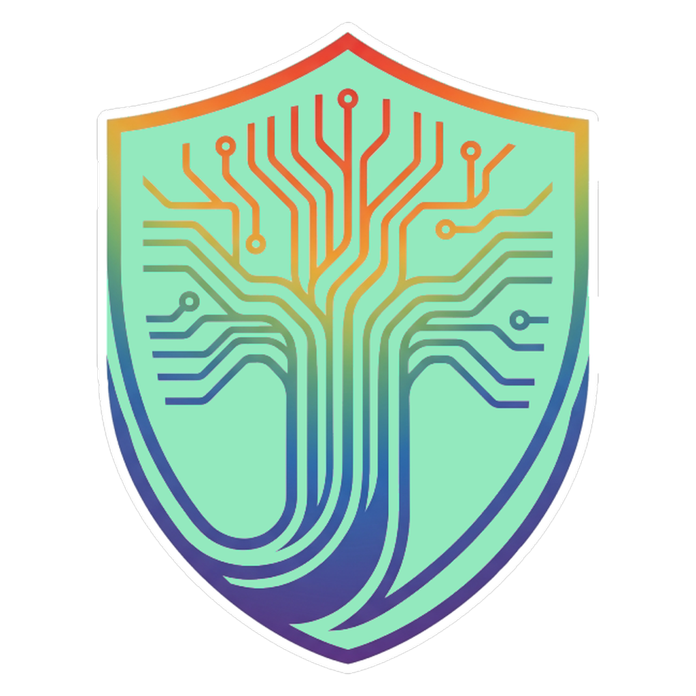
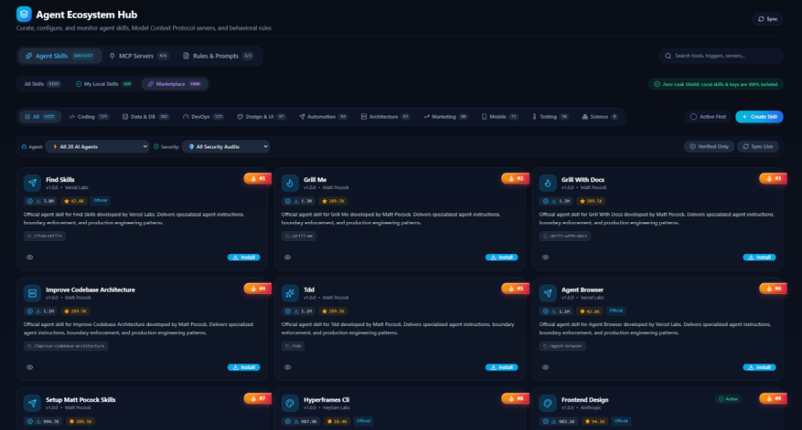
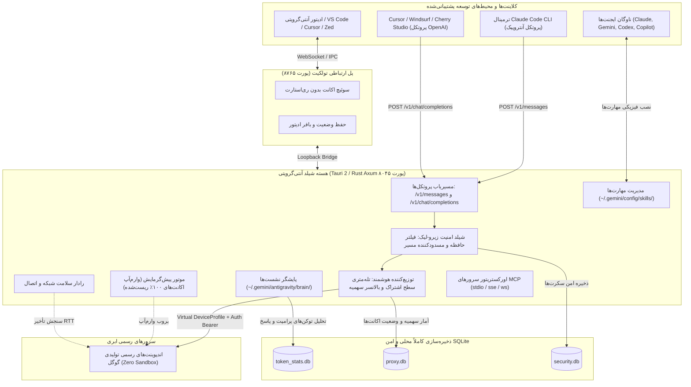

# شیلد آنتی‌گرویتی (Antigravity Shield) 🛡️
> **مرکز مدیریت فوق‌پیشرفته چند حسابه هوش مصنوعی، مارکت‌پلیس جهانی مهارت‌های ایجنت و گیت‌وی محلی زیرو-لیک**  
> *نسخه ۶.۰.۰ — توسعه‌یافته با هسته قدرتمند Rust (Axum / Tokio) و React 19 (Tauri 2)*

<div align="center">
  

  <h3>چرخش خودکار سهمیه‌ها • بیش از ۱,۰۰۰ مهارت ایجنت • امنیت محلی Zero-Leak • سوئیچ اکانت بدون بستن IDE</h3>

  <p>
    <a href="https://github.com/doctorguidance/antigravity-shield/releases"></a>
    
    
    
    
    
    
    
  </p>

  <p>
    <a href="./README.md">English (Master)</a> • 
    <a href="./README_EN.md">English (Pure)</a> • 
    <strong>فارسی</strong> • 
    <a href="./README_ZH.md">简体中文</a>
  </p>
</div>

---

<div dir="rtl">

## ⚡ نگاه کلی به سیستم

**شیلد آنتی‌گرویتی (Antigravity Shield)** یک نرم‌افزار دسکتاپ کراس‌پلتفرم فوق‌العاده سبک، مدرن و با معماری سخت‌گیرانه صنعتیه که برای توسعه‌دهنده‌ها، مهندسان سیستم و ایجنت‌های کدنویسی خودکار طراحی شده. این ابزار به عنوان پل ارتباطی بین ایجنت‌های پیشرفته کدنویسی (مثل **Google Antigravity**, **Claude Code CLI**, **Cursor**, **Windsurf**, **Gemini CLI**, **Zed**) و زیرساخت حساب‌های متعدد هوش مصنوعی عمل می‌کنه.

این سیستم روی پورت‌های محلی `127.0.0.1:8045` و `127.0.0.1:8765` اجرا می‌شه و امکان چرخش هوشمند اکانت‌ها، تله‌متری دقیق سهمیه‌ها بر اساس نوع اشتراک (Pro، Ultra و Free)، جابجایی بدون توقف (Failover آنی با تأخیر ۰ میلی‌ثانیه)، سوئیچ اکانت فعال در ادیتور بدون نیاز به ری‌استارت IDE و دسترسی به **بیش از ۱,۰۰۰ مهارت آماده استاندارد ایجنت** رو فراهم می‌کنه.


---

## 🛡️ چرا شیلد آنتی‌گرویتی؟ (راهکار جامع ضد ۴۰۳ / The Anti-403 Solution)

در حالی که پروژه بالادست (`lbjlaq/Antigravity-Manager`) صرفاً یک فریم‌ورک پروکسی پایه بود، زیر بار ترافیک بالای ایجنت‌های مدرن کدنویسی (مثل Claude Code CLI، Cursor، Windsurf، OpenCode و OpenClaw) بیش از **۱,۸۰۰ ایشیو و گزارش باگ** انباشته شد؛ مشکلاتی از قبیل خطاهای مسدودی ۴۰۳، بن‌بست رشته‌های پردازشی، افت درخواست‌ها و سوختن آبشاری حساب‌ها.

**آنتی‌گرویتی شیلد (Antigravity Shield)** یک توزیع مستقل، فوق‌سخت‌کاری‌شده و سازمانیه که این ریشه‌ها رو به شکل ساختاریافته در چهار لایه پروکسی، چرخش اکانت، پل ارتباطی IDE و شبکه برطرف کرده.

### 📊 جدول مقایسه معماری و پایداری (Reliability Comparison)

| بُعد معماری و پایداری | نسخه پایه و بالادست (`lbjlaq/Antigravity-Manager`) | 🛡️ آنتی‌گرویتی شیلد (نسخه سخت‌کاری‌شده سازمانی) |
| :--- | :--- | :--- |
| **مسیریابی بالادست و امنیت API** | ❌ ارسال درخواست‌ها از اندپوینت‌های اعتبارسنجی‌نشده، که منجر به مسدودی امنیتی و تعلیق اکانت‌ها می‌شه. | ✅ **خروجی مقید به پروداکشن (Strict Production Egress):** ارسال ۱۰۰٪ درخواست‌ها فقط از اندپوینت‌های معتبر با حفظ یکپارچگی هدرها و صفر درصد مسیریابی مشکوک. |
| **ایزولاسیون هویت و حساب‌ها** | ❌ اشتراک یک فوت‌پرینت سخت‌افزاری واحد میان تمامی اکانت‌ها، که باعث شناسایی ارتباط کلاستر و پرچم‌گذاری می‌شه. | ✅ **پروفایل سخت‌افزاری مجازی مجزا (Virtual Device Profile):** تخصیص شناسه سخت‌افزاری ایزوله و UUID قطعی به ازای هر حساب برای قطع کامل ارتباط متقابل. |
| **تفکیک خطا و حفاظت از حساب‌ها** | ❌ پدیده سوختن دومینویی که در اون چالش یک اکانت بلافاصله به کل استخر حساب‌ها سرایت می‌کنه. | ✅ **ایزولاسیون چندلایه‌ای خطا (Multi-Tier Fault Isolation):** قرنطینه هوشمند و بافرهای خنک‌سازی خودکار جهت جلوگیری از سوختن زنجیره‌ای حساب‌های سالم. |
| **معماری همروندی بالا (Concurrency)** | ❌ رشته‌های ترتیبی همگام و I/O مسدودکننده دیسک، که زیر ترافیک سنگین ایجنت‌ها باعث بن‌بست (Deadlock) و تایم‌اوت می‌شه. | ✅ **موتور ناهمگام غیرمسدودکننده (Non-Blocking Async):** خط لوله کاملاً ناهمگام بر پایه Rust (Axum/Tokio) با کش وضعیت مجزا و قفل‌های ریزدانه زیر فشار ایجنتی. |
| **حفظ پنجره کانتکست (Context)** | ❌ رانش سشن و انباشت بی‌رویه توکن‌ها که کانتکست رو بی‌جهت به سقف مصرف می‌رسونه. | ✅ **تطبیق هوشمند جریان کانتکست:** نرمال‌سازی نوبت‌های گفتگو و بهینه‌سازی تاریخچه استدلال برای مصرف بهینه و قابل‌پیش‌بینی توکن‌ها. |
| **پایداری پروتکل ابزارهای ایجنت** | ❌ توقف اجرای ایجنت هنگامی که مدل‌ها فراخوانی ابزارها رو در استریم‌های بدون ساختار ارسال می‌کنن. | ✅ **ترجمه خطاناپذیر پروتکل:** انطباق پایدار و دوطرفه پروتکل‌ها که اجرای چندمرحله‌ای و بی‌وقفه ابزارهای ایجنتی رو تضمین می‌کنه. |
| **تاب‌آوری شبکه و محدودیت‌های منطقه‌ای** | ❌ قطع کامل ارتباط روی خطاهای منطقه‌ای سرور با صفر قابلیت تلاش مجدد. | ✅ **مسیریابی تطبیقی و فیل‌اور خودکار:** استراتژی‌های هوشمند تلاش مجدد در سطح انتقال، ردیاب Cloudflare WARP و سوییچ خودکار برای حفظ سشن‌های زنده. |
| **سوئیچینگ اکانت در محیط IDE** | ❌ الزام به بستن و باز کردن مجدد ادیتور، که باعث نابودی ترمینال‌ها، بافرهای ذخیره‌نشده و لوپ‌های ایجنت می‌شه. | ✅ **پل سوئیچ زنده بدون بستن ادیتور (Zero-Restart Bridge):** جابجایی در لحظه و درون‌حافظه‌ای حساب‌ها روی پورت ۸۷۶۵ بدون حتی ۱ میلی‌ثانیه قطعی یا ری‌استارت IDE. |
| **تاب‌آوری در برابر کرش و قطعی برق** | ❌ بسته شدن ناگهانی برنامه یا قطعی برق تاریخچه چت‌های ثبت‌نشده در ادیتور رو برای همیشه نابود می‌کرد. | ✅ **تطبیق و تزریق خودکار وضعیت (Protobuf Injection):** اسکن دیسک، سنتز دیسکریپتورهای ترجکتوری و تزریق سشن‌ها به دیتابیس بومی ادیتور (`state.vscdb`) بدون ۱ بایت اتلاف دیتا. |
| **اعتبارسنجی خودکار و پیوسته** | ❌ تست دستی با ریسک بالای رگرسیون پروتکل و رفتارهای پیش‌بینی‌نشده زیر بار. | ✅ **تست‌های رگرسیون ۱۰۰٪ خودکار:** بیش از ۲۶۰ سوئیت تست خودکار E2E که سلامت کامل سیستم رو در هر بیلد تضمین می‌کنه. |

---

## 🚀 قابلیت‌های کلیدی و آپگریدهای تجاری (Killer Features)

| قابلیت کلیدی | تشریح عملکرد | دستاورد مهندسی |
| :--- | :--- | :--- |
| 🛡️ **بازیابی ضدکرش سشن‌ها (Zero Data Loss)** | کیت اختصاصی Antigravity Toolkit 2.5.0 و اسکنر دیسک شیلد به محض قطعی برق یا کرش ناگهانی، مکالمات ناتمام ایجنت رو شناسایی و بازیابی می‌کنن. | تطبیق خودکار لاگ‌های متنی دیسک (`~/.gemini/antigravity/brain/`) با دیتابیس ادیتور (`state.vscdb`)، تزریق خلاصه‌های Protobuf و تضمین تداوم ۱۰۰٪ سشن‌ها. |
| 🔌 **سوئیچینگ بدون ری‌استارت IDE (Zero-Restart)** | اکستنشن Antigravity Toolkit 2.5.0 امکان جابجایی ۱-کلیک اکانت‌ها داخل Antigravity IDE، VS Code، JetBrains و Zed رو بدون بستن پنجره فراهم می‌کنه. | بافرهای ذخیره‌نشده فایل‌ها، وضعیت ترمینال و لوپ‌های استدلال ایجنت از طریق پل لوپ‌بک محلی (`127.0.0.1:8765`) کاملاً دست‌نخورده و فعال باقی می‌مونن. |
| 🧠 **اسکنر مستقل برین و تاریخچه گفتگوها** | موتور بومی Rust `brain_scanner` لاگ‌های سیستم (`~/.gemini/antigravity/brain/`) رو هر ۳ ثانیه یک‌بار رصد کرده و مصرف توکن‌ها رو ثبت می‌کنه. | پارس خودکار توکن‌های پرامپت و پاسخ، تشخیص مدل‌ها و ساخت درخت گفتگو داخل پایگاه داده تحلیلی محلی SQLite. |
| 💓 **پالس سلامت زنده و رادار شبکه منطقه‌ای** | تست بلادرنگ پینگ و پایداری به APIهای پروداکشن گوگل، اندپوینت‌های Gemini و اینترنت بین‌الملل. | دارای ردیاب داخلی Cloudflare WARP و راهنمای گام‌به‌گام رفع ارورهای لوکیشن (HTTP 400 Location Error) در مناطق تحریم‌شده. |
| 📊 **هیت‌مپ ۵۳ هفته‌ای سالانه مصرف توکن** | تقویم مشارکتی جذاب مشابه گیت‌هاب که حجم مصرف توکن در طول کل سال رو در ۵ سطح شدت نور به تصویر می‌کشه. | فیلتر دقیق مصرف به تفکیک Antigravity IDE، ابزار خط فرمان `agy` و گیت‌وی پروکسی همراه با امکان کلیک و بررسی روزانه. |
| 🇮🇷 **موتور فونت وزیرمتن و پشتیبانی بومی RTL** | تزریق غیرمخرب استایل با ۱ کلیک به محیط Antigravity IDE و دسکتاپ با تایپوگرافی زیبا و چشم‌نواز وزیرمتن. | اعمال استاندارد `unicode-bidi: plaintext` با حفظ کامل تراز چپ‌به‌راست و هایلایت نحوی بلوک‌های کد و توکن‌های مونو‌اسپیس. |
| 🔄 **موتور آپدیت مستقیم جریانی و بدون قطعی** | سیستم دانلود استریمینگ با نوار پیشرفت درصد واقعی، اعتبارسنجی امضای دیجیتال Minisign و تحویل مستقل به نصاب. | ریشه‌کنی کامل دانلودهای دستی از مرورگر، تایم‌اوت‌های آزاردهنده و توقف در حین به‌روزرسانی. |
| 🪟 **ویجت شناور MiniView و HUD بدون فریم دسکتاپ** | ویجت اولترافشرده شناور (تا ابعاد ۱۱۰ در ۵۲ پیکسل) با گیج‌های زنده سهمیه، سوئیچر اکانت و کنترل‌های بومی پنجره ویندوز. | مانیتورینگ بلادرنگ سهمیه مدل‌ها و سوئیچ اکانت بدون اشغال صفحه یا پوشاندن ادیتور کدنویسی. |
| 🔥 **پیش‌گرمایش هوشمند با شارژ ۱۰۰٪ سهمیه** | پروب‌های خودکار سبک در پس‌زمینه که به محض بازنشانی سهمیه ۵ ساعته یا هفتگی، اکانت آماده‌شده رو وارم می‌کنن. | ریشه‌کنی قطعی تأخیر استارت سرد (Cold-Start Latency) در اولین درخواست پس از شارژ مجدد سهمیه‌ها. |

---

## 🌟 ستون‌های هفت‌گانه معماری شیلد

### ۱. 🛡️ پروکسی و گیت‌وی پرسرعت مدیریت سهمیه چند حسابه
* **پروکسی معکوس محلی با Rust Axum و Tokio (پورت `8045`):** پردازش کاملاً ناهمگام و غیرمسدودکننده، بدون ایجاد گلوگاه و قفل‌های پردازشی زیر ترافیک سنگین ابزارهای ایجنتی.
* **تله‌متری دقیق سطح اشتراک (Pro vs Free vs Ultra):**
  - طبقه‌بندی خودکار اکانت‌ها به سطوح **`PRO`**، **`ULTRA`** و **`FREE`**.
  - هدایت هوشمند مدل‌ها بر اساس ظرفیت (مثلاً اختصاص مدل‌های سنگین استدلالی مثل Claude 3.7 و Gemini 3.1 Pro به اکانت‌های سطح بالا و انجام کارهای سبک روی استخرهای پرظرفیت).
  - محاسبه بلادرنگ درصد باقی‌مانده سهمیه و تایمرهای شمارش معکوس برای پنجره‌های بازنشانی ۵ ساعته و سقف مصرف هفتگی.
* **سوئیچینگ هوشمند و بدون قطعی (Smart Failover):** هدایت ترافیک به اکانت با بیشترین سهمیه دردسترس. در صورت وقوع خطای لیمیت (HTTP 429)، درخواست‌ها بدون ایجاد وقفه یا کرش کردن تسک‌های در حال اجرا به اکانت بعدی منتقل می‌شن.
* **موتور پیش‌گرمایش خودکار و پروبینگ بدون تأخیر (Auto-Warmup & Probing):**
  - **ریشه‌کنی استارت سرد:** در سرویس‌های عادی وقتی مهلت ۵ ساعته یا سهمیه هفتگی ریست می‌شه، اولین درخواست کاربر دچار افت سرعت و پینگ مجدد سهمیه می‌شه.
  - **پروبینگ هوشمند شیلد:** آنتی‌گرویتی شیلد به محض صفر شدن ثانیه‌شمار ریست، در پس‌زمینه یک سیگنال سبک و بدون سربار ارسال می‌کنه تا کوتای اکانت ۱۰۰٪ شارژ و اعتبارسنجی بشه؛ بنابراین قبل از اینکه شما حتی پرامپت بعدی رو تایپ کنید، حساب بعدی در اوج آمادگیه.
* **یکپارچگی با System Tray و زمان‌بند پس‌زمینه:** آیکون مقیم در کنار ساعت ویندوز/مک، اجرای خودکار همراه با روشن شدن سیستم، سرویس پایش سلامت شبکه و ارسال اعلان‌های دسکتاپ.

---

### ۲. 🔒 معماری امنیت و حریم خصوصی Zero-Leak
* **حبس کامل داده‌ها روی سیستم محلی:** کلیدهای خصوصی API، توکن‌های OAuth، قوانین سفارشی و داده‌های محرمانه سازمانی تحت هیچ شرایطی از سیستم شما خارج نمی‌شن. هیچ دیتایی به سرورهای واسط ارسال نمی‌شه.
* **گاردهای پاک‌سازی درون حافظه (Live Memory Shields):**
  - پاک‌سازی خودکار هدرهای حساس احراز هویت (Bearer Tokens) از لاگ‌های تله‌متری و دیباگ.
  - گارد امنیتی ضد Directory Traversal برای جلوگیری از تزریق مسیرهای مخرب (`../`) موقع خواندن اسناد `SKILL.md`.
  - اسکن و حذف خودکار بیش از ۱۲ الگوی کلیدهای حساس (کلیدهای OpenAI، سکرت‌های AWS و توکن‌های Anthropic) در اسکن فایل‌ها.
* **پایگاه داده محلی SQLite با رمزنگاری:** تمام اطلاعات حساب‌ها و آمار مصرف توکن‌ها داخل دیتابیس‌های لوکال (`proxy.db`، `token_stats.db` و `security.db`) در مسیر دیتای برنامه ذخیره می‌شن.
* **ایزولاسیون هویت سخت‌افزاری (Virtual Device Profile):** برای هر حساب، یک اثر انگشت سخت‌افزاری مجازی و UUID مستقل تولید می‌شه تا سرورهای بالادست نتونن ارتباط چند اکانت رو با هم رهگیری کنن.

---

### ۳. 🪐 مارکت‌پلیس و اکوسیستم جهانی بیش از ۱,۰۰۰ مهارت ایجنت
* **استاندارد جهانی `SKILL.md`:** ساختار یکپارچه دانش رویه‌ای که توسط بیش از ۲۰ پلتفرم ایجنت دنیا پشتیبانی می‌شه.

<div align="center">
  
  <p><em>تصویر: هاب جامع مهارت‌های آنتی‌گرویتی شیلد — دسترسی به بیش از ۱,۰۰۰ مهارت، ۱۱ دامنه تخصصی، تله‌متری زنده دانلودها و نصب ۱-کلیک.</em></p>
</div>

* **۱۱ حوزه تخصصی و دسته‌بندی سطح یک:**
  1. `کدنویسی و توسعه وب` (`coding`): فرانت‌اند، ری‌اکت ۱۹، نود جی‌اس، سوئیفت، راست، پایتون، گو.
  2. `دیتابیس و بهینه‌سازی داده` (`data`): کوئری‌های پستگرس، تیونینگ SQL، سوپابیس، ردیس.
  3. `دِوآپس و زیرساخت ابری` (`devops`): داکر، کوبرنتیز، Nginx، خطوط CI/CD، ورکرها.
  4. `طراحی و ارگونومی UI/UX` (`design`): استانداردهای اپل، Tailwind CSS، فریمور موشن، میکرواینترکشن‌ها.
  5. `اتوماسیون و ایجنت‌های هوشمند` (`automation`): سوارمز، ربات‌های تلگرام، اتوماسیون مرورگر.
  6. `معماری و مهندسی سیستم‌ها` (`architecture`): سیستم‌های توزیع‌شده، کلین آرکیتکچر، میکروسرویس‌ها.
  7. `مارکتینگ و استراتژی رشد` (`marketing`): کپی‌رایتینگ وایرال، سئوی الگوریتمی، روانشناسی فروش.
  8. `توسعه موبایل و کراس‌پلتفرم` (`mobile`): ری‌اکت نیتیو، اکسپو، فلاتر، سوئیفت ۶ و ابزارهای اندروید.
  9. `تست و تضمین کیفیت نرم‌افزار` (`testing`): پلی‌رایت، تست رگرسیون، حسابرسی باگ‌های لبه.
  10. `علوم تجربی و پژوهش‌های علمی` (`science`): آلفافولد، بیوانفورماتیک، پاب‌مد، تحلیل‌های آماری زیستی.
  11. `فهرست جامع و سرچ جهانی` (`all`): جستجوی سریع و فیلتر ترکیبی در میان کل ۱,۰۰۰ مهارت.
* **نصب فیزیکی تک‌کلیک:** قرار دادن فایل‌های مهارت مستقیماً در مسیر واقعی ایجنت:
  - ویندوز: `%USERPROFILE%\.gemini\config\skills\<skill-name>\SKILL.md`
  - مک / لینوکس: `~/.gemini/config/skills/<skill-name>/SKILL.md`
* **کپی فوری دستورات اسلش:** کپی راحت دستورات آماده (مثل `/find-skills`، `/animate`، `/apple-design`) برای درج در چت ایجنت.
* **نمایشگر اسناد دوزبانه:** تب‌های تفکیک‌شده انگلیسی و فارسی (`fa`) همراه با پیام‌های راهنما، نمونه کدها و پیش‌نمایش زنده مارک‌داون.
* **پشتیبانی وسیع از محیط‌های هوش مصنوعی:** گوگل آنتی‌گرویتی، کلود کد (Claude Code CLI)، کرسر (Cursor)، زِد (Zed)، ویندسرف (Windsurf)، کدکس، کوپایلوت، کلاین، رو کد و بیش از ۱۵ ابزار مدرن.

---

### ۴. 🔌 مدیریت بصری سرورهای پروتکل MCP (Model Context Protocol)
* **کاتالوگ یکپارچه سرورها:** مدیریت سرورهای محلی و ریموت stdio، SSE و WebSocket در یک داشبورد تمیز.
* **تست زنده تأخیر (Ping Latency):** سنجش بلادرنگ پینگ و در دسترس بودن سرورها قبل از ارسال تسک.
* **همگام‌سازی خودکار کانفیگ:** تطبیق دوطرفه تنظیمات بین فایل‌های پیکربندی کلود و آنتی‌گرویتی (`claude_desktop_config.json` و `antigravity_mcp.json`).
* **اعتبارسنجی باینری‌های اجرایی:** تشخیص اینکه آیا ابزارهای موردنیاز سرور (مثل `npx`، `uvx`، `docker`) روی سیستم نصب هستن یا نه.

---

### ۵. 📜 مدیریت هوشمند قوانین سیستم و پرسوناهای هوش مصنوعی
* **قوانین چندسطحی:** امکان تعریف راهنماها و قوانین در سطح کل سیستم (Global) یا اختصاصی برای هر پروژه (Workspace).
* **حالت‌های تریگر پویا:** پشتیبانی از حالت اعمال پیوسته (`always_on`) و تصمیم‌گیری مدل بر اساس زمینه (`model_decision`).
* **بک‌آپ غیرمخرب:** نگهداری نسخه‌های پشتیبان با پسوند `.bak` برای بازگردانی سریع در صورت نیاز.

---

### ۶. 🎨 طراحی با استانداردهای اپل و پچ تایپوگرافی فارسی
* **انیمیشن‌های فیزیکی نرم:** حرکت‌های ارگونومیک و سوئیچ تب‌ها با Framer Motion.
* **موتور پیمایش مجازی:** رندر بیش از ۱,۰۰۰ کارت با `@tanstack/react-virtual` بدون کوچک‌ترین افت فریم یا سنگین شدن حافظه.
* **داشبورد شناور MiniView HUD:** ویجت مینیاتوری شناور با قابلیت پین شدن بالای ادیتور کد و نمایش وضعیت مصرف سهمیه‌ها در ابعاد فوق فشرده.
* **پچ ۱-کلیک فونت وزیرمتن و راست‌چین:** بهینه‌سازی خوانایی متون فارسی در محیط دسکتاپ و ادیتور بدون دستکاری و به هم ریختن قالب چپ‌به‌راست کدهای برنامه‌نویسی.

---

### ۷. 🔌 سوئیچ بلادرنگ اکانت بدون ری‌استارت IDE و ریکاوری کرش
* **پل لوپ‌بک تولکیت (`127.0.0.1:8765`):**
  - **مشکل بنیادین در ابزارهای متداول:** در حالت عادی برای تغییر اکانت هوش مصنوعی، باید ادیتور رو ببندید، لاگ‌اوت کنید، دوباره لاگین کنید، پروژه‌ها رو از نو باز کنید و تسک‌های در حال اجرای ترمینال رو بکشید که باعث پریدن کانتکست و تمرکز مدل می‌شه.
  - **شاهکار مهندسی شیلد (Zero-Restart Hot-Switching):** شیلد یک بریج لوکال پرسرعت روی پورت `8765` اجرا می‌کنه. با تغییر اکانت در شیلد، توکن‌های احراز هویت مستقیماً زیرِ پای پروسه‌های در حال اجرای ادیتور (Antigravity IDE / VS Code / Cursor / Zed) تعویض می‌شن؛ بدون بستن پنجره‌ها، بدون بسته شدن بافرها، و بدون قطع شدن استریم پاسخ ایجنت!
* **اسکنر خودکار نشست‌های کاری:** پایش مداوم فولدر `~/.gemini/antigravity/brain/` برای ثبت دقیق مصرف توکن‌ها.
* **ریکاوری هوشمند تاریخچه با Protobuf:** بازسازی گفتگوهای ثبت‌نشده در دیتابیس `state.vscdb` در صورت قطع ناگهانی برق یا ری‌استارت ناگهانی سیستم‌عامل.

---

## 🏗️ دیاگرام معماری شیلد



---

## 🔌 راهنمای اتصال سریع

### ۱. اجرای Claude Code CLI
پروکسی محلی شیلد رو اجرا کنین (پورت پیش‌فرض: `8045`) و در خط فرمان دستورات زیر رو بزنین:

**ویندوز پاورشل (PowerShell):**
```powershell
$env:ANTHROPIC_API_KEY = "sk-antigravity"
$env:ANTHROPIC_BASE_URL = "http://127.0.0.1:8045"
claude
```

**مک و لینوکس (Bash/Zsh):**
```bash
export ANTHROPIC_API_KEY="sk-antigravity"
export ANTHROPIC_BASE_URL="http://127.0.0.1:8045"
claude
```

### ۲. اتصال در Cursor / Windsurf / Cherry Studio
* **آدرس Base URL:** `http://127.0.0.1:8045/v1`
* **کلید API Key:** `sk-antigravity`
* **شناسه مدل‌ها:**
  - `gemini-3-pro-high` (مدل اصلی و قدرتمند استدلالی)
  - `gemini-3-flash` (مدل فوق‌سریع برای کدنویسی روزمره)
  - `gemini-3.1-pro-preview` (مدل استدلال عمیق)
  - `gemini-3.1-flash-image` (تحلیل مولتی‌مودال و تصویر باکیفیت)
  - `claude-sonnet-4-6` / `claude-3-7-sonnet` (مدل هیبریدی فکر و اجرا)
  - `claude-opus-4-6-thinking` (مدل تحلیلی معماری)

### ۳. فراخوانی با کتابخانه پایتون (`openai` SDK)
```python
from openai import OpenAI

client = OpenAI(
    api_key="sk-antigravity",
    base_url="http://127.0.0.1:8045/v1"
)

response = client.chat.completions.create(
    model="gemini-3-flash",
    messages=[
        {"role": "system", "content": "You are Juliet, Principal Systems Architect."},
        {"role": "user", "content": "بررسی ریت‌لیمیتینگ توزیع‌شده با ردیس"}
    ],
    temperature=0.2
)

print(response.choices[0].message.content)
```

---

## 🛠️ استک فنی سیستم

| لایه | تکنولوژی | علت انتخاب و وظیفه |
| :--- | :--- | :--- |
| **پوسته دسکتاپ** | **Tauri 2.x** | سبک، بومی و با مصرف حافظه بسیار ناچیز (~۴۵ مگابایت رم). |
| **بک‌اند گیت‌وی** | **Rust** (Axum, Tokio, Hyper, Tower) | عملکرد غیرمسدودکننده با توان پردازش همزمان صدها درخواست ابزارهای ایجنتی. |
| **فرانت‌اند** | **React 19** + **TypeScript** | بهره‌گیری از هماهنگی همزمانی استیت‌ها در ری‌اکت ۱۹ و تایپینگ سخت‌گیرانه. |
| **استایل و حرکت** | **Tailwind CSS** + **Framer Motion 11** | ارگونومی عالی، فیزیک فنری اپل و تم‌های دارک/لایت. |
| **نمایش مجازی** | **@tanstack/react-virtual 3.x** | رندر ۶۰ فریم بدون لگ برای بیش از ۱,۰۰۰ کارت مهارت. |
| **داده‌های لوکال** | **Rusqlite (SQLite)** + **Zustand 5** | ذخیره‌سازی رمزنگاری‌شده محلی و مدیریت استیت اتمیک و سریع فرانت. |
| **چندزبانه** | **i18next** | پشتیبانی دوطرفه از زبان فارسی و انگلیسی همراه با تغییر جهت راست‌چین (RTL). |

---

## 📦 نحوه نصب و راه‌اندازی

### روش اول: دانلود فایل‌های اجرایی آماده (پیشنهادی)
آخرین نسخه کامپایل‌شده رو از [صفحه ریلیزهای گیت‌هاب](https://github.com/doctorguidance/antigravity-shield/releases/latest) دانلود کنین:
* **ویندوز (x64):** `Antigravity.Shield_6.0.0_x64-setup.exe` (یا نسخه پرتابل زیپ)
* **مک:** فایل `.dmg` (باینری یونیورسال برای مک‌های اینتل و اپل سیلیکون)
* **لینوکس:** فایل‌های `.deb` یا `.AppImage`

### روش دوم: بیلد از سورس کد
```bash
# ۱. کلون کردن ریپازیتوری
git clone https://github.com/doctorguidance/antigravity-shield.git
cd antigravity-shield

# ۲. نصب وابستگی‌های فرانت‌اند
npm install

# ۳. اجرای محیط دولوپمنت
npm run tauri dev

# ۴. خروجی نهایی پروداکشن
npm run build
npm run tauri build
```

---

## ⚖️ لایسنس و حقوق بازنشر

- **لایسنس:** تحت مجوز **Creative Commons Attribution-NonCommercial-ShareAlike 4.0 International (CC BY-NC-SA 4.0)** برای استفاده شخصی و توسعه غیرتجاری.
- **اصالت کد:** شیلد آنتی‌گرویتی یک نسخه مستقل، امن‌سازی‌شده و توسعه‌یافته بر پایه پروژه منبع‌باز [lbjlaq/Antigravity-Manager](https://github.com/lbjlaq/Antigravity-Manager) ساخته شده توسط [lbjlaq](https://github.com/lbjlaq) است و کلیه حقوق و اعتبارات توسعه‌دهندگان پیشین محفوظ است.
- **تعهد حریم خصوصی:** هیچ داده‌ای از نشست‌ها، کلیدها و کدهای شما به خارج از سیستم‌تان مخابره نخواهد شد.

</div>

---

<div align="center">
  <p><strong>شیلد آنتی‌گرویتی</strong> — طراحی‌شده برای پایداری ۱۰۰٪، امنیت کامل داده‌ها و شتاب‌دهی به کدنویسی با ایجنت‌های هوشمند.</p>
  <p>Copyright © 2024–2026 DoctorGuidance & Antigravity Shield Contributors.</p>
</div>
